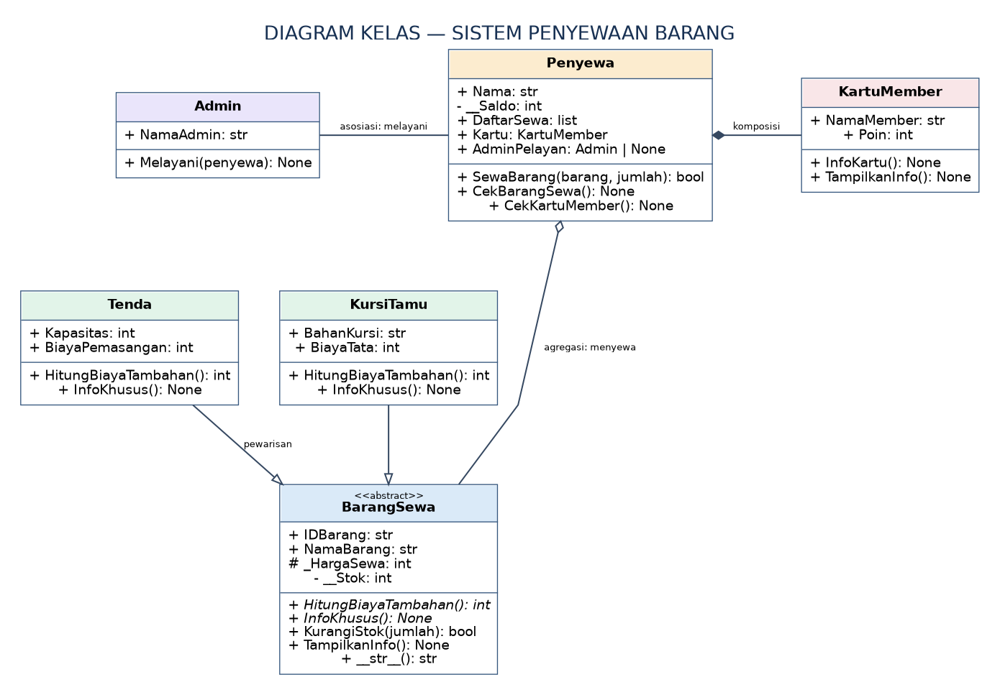
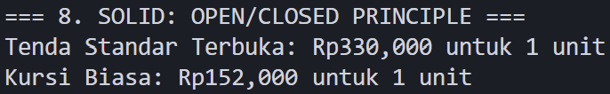
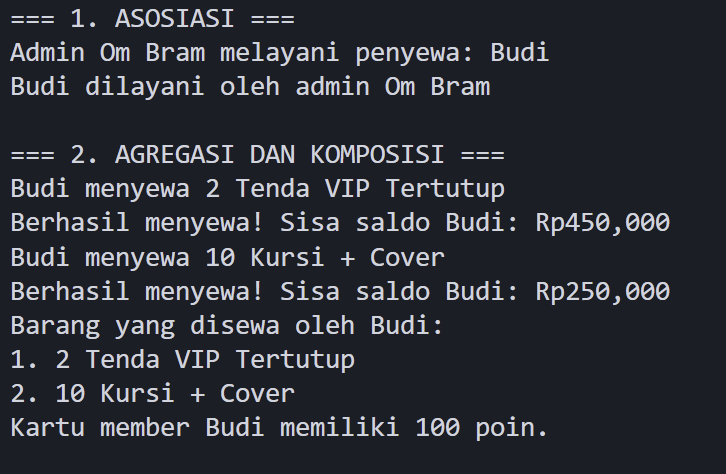
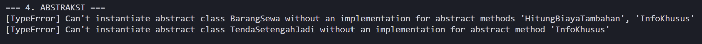
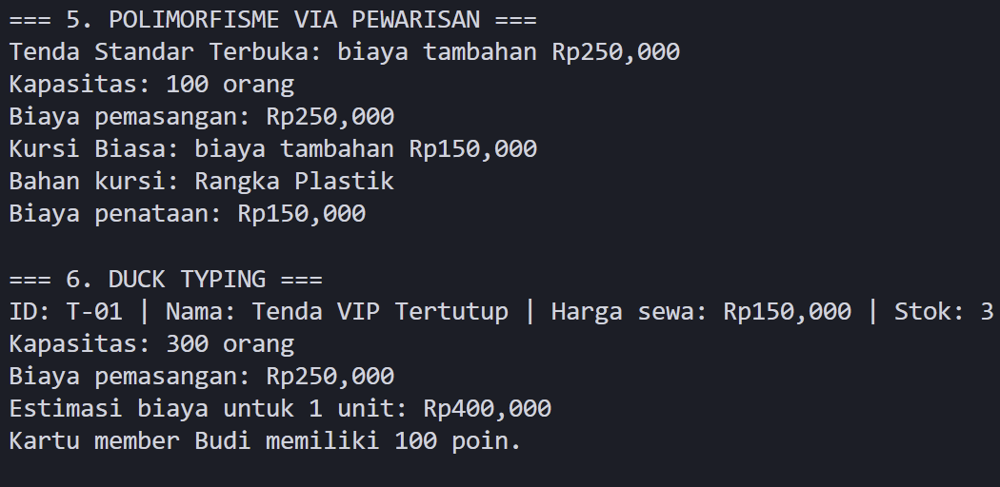
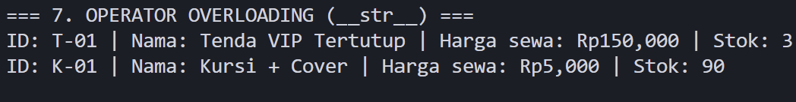

# Sistem Penyewaan Tenda dan Kursi Tamu

# 1. Deskripsi Program
Program ini merupakan sistem penyewaan tenda dan kursi tamu sederhana yang dibuat menggunakan bahasa pemrograman Python dengan menerapkan konsep Pemrograman Berorientasi Objek (PBO).

Program ini memungkinkan penyewa melakukan penyewaan barang berdasarkan stok yang tersedia dan saldo yang dimiliki. Selain itu program ini juga memiliki fitur pelayanan admin, kartu member, perhitungan biaya tambahan, serta validasi data.

## Konsep PBO yang diterapkan meliputi:
- Class dan Object
- Enkapsulasi
- Inheritance (Pewarisan)
- Abstraksi
- Polimorfisme
- Asosiasi, Agregasi, dan Komposisi
- Operator Overloading
- Prinsip SOLID (Open/Closed Principle)

# 2. UML Class Diagram
Berikut adalah Class Diagram dari sistem penyewaan tenda dan kursi tamu.

## A. Asosiasi (Association)
Relasi asosiasi terjadi antara class `Admin` dan `Penyewa` melalui method `Melayani()`.

Class `Admin` melayani objek `Penyewa` dan menyimpan hubungan melalui atribut `AdminPelayan`. Kedua objek dapat dibuat dan digunakan secara terpisah.

## B. Agregasi (Aggregation)
Relasi agregasi terjadi antara class `Penyewa` dan `BarangSewa`.

Class `Penyewa` menyimpan referensi objek `BarangSewa` melalui atribut `DaftarSewa` ketika melakukan penyewaan. Objek barang dapat tetap ada secara independen meskipun objek penyewa dihapus.

## C. Komposisi (Composition)
Relasi komposisi terjadi antara class `Penyewa` dan `KartuMember`.

Objek `KartuMember` dibuat langsung di dalam constructor `Penyewa` menggunakan `self.Kartu = KartuMember(self.Nama)`. Dalam desain program ini, kartu member merupakan bagian dari penyewa dan kepemilikannya dikelola oleh objek penyewa.

# 3. Penerapan Abstraksi
Abstraksi diterapkan menggunakan abstract class `BarangSewa` yang mewarisi `ABC` dari modul `abc`.

Abstract class `BarangSewa` memiliki dua abstract method:
- `HitungBiayaTambahan()`
- `InfoKhusus()`

Kedua method tersebut wajib diimplementasikan oleh subclass `Tenda` dan `KursiTamu`.

Selain itu, class `BarangSewa` juga memiliki method konkret seperti `KurangiStok()`, `HitungEstimasiBiaya()`, dan `TampilkanInfo()` yang dapat digunakan oleh seluruh subclass.

Pembuktian abstraksi dilakukan dengan mencoba membuat objek langsung dari class `BarangSewa` dan class `TendaSetengahJadi` yang belum mengimplementasikan seluruh abstract method.

Percobaan tersebut menghasilkan `TypeError`, sehingga membuktikan bahwa abstract class tidak dapat diinstansiasi sebelum seluruh abstract method diimplementasikan.

# 4. Penerapan Polimorfisme
## A. Polimorfisme melalui Pewarisan
Polimorfisme melalui pewarisan diterapkan pada class `Tenda` dan `KursiTamu` yang merupakan subclass dari `BarangSewa`.

Kedua subclass melakukan overriding pada method:
- `HitungBiayaTambahan()`
- `InfoKhusus()`

Method `HitungBiayaTambahan()` menghasilkan biaya pemasangan pada class `Tenda` dan biaya penataan pada class `KursiTamu`.

Objek dari kedua subclass dipanggil melalui satu perulangan `for` sehingga method yang sama menghasilkan perilaku berbeda sesuai jenis objek.

## B. Duck Typing
Duck typing diterapkan pada class `BarangSewa` dan `KartuMember`.

Kedua class tidak memiliki hubungan pewarisan, tetapi sama-sama menyediakan method `TampilkanInfo()`.

Fungsi `TampilkanObjek()` menerima objek yang memenuhi kontrak `DapatDitampilkan` (Protocol), kemudian memanggil method `TampilkanInfo()` tanpa perlu memeriksa class objek tersebut.

## C. Operator Overloading
Operator overloading diterapkan melalui special method `__str__()` pada class `BarangSewa`.

Method ini digunakan untuk menghasilkan informasi objek dalam bentuk string yang mudah dibaca ketika objek ditampilkan menggunakan fungsi `print()`.

# 5. Penerapan Prinsip SOLID
Program menerapkan prinsip Open/Closed Principle (OCP)

Prinsip ini diterapkan melalui abstract class `BarangSewa` dan method `SewaBarang()` pada class `Penyewa`.

Method `SewaBarang()` menerima objek bertipe `BarangSewa`, sehingga dapat digunakan untuk menyewakan berbagai subclass seperti `Tenda` dan `KursiTamu`.

Apabila jenis barang baru ditambahkan sebagai subclass dari `BarangSewa` dan mengimplementasikan seluruh abstract method, logika utama pada method `SewaBarang()` tidak perlu diubah.

# 6. Screenshot Output Program
## A. Output Asosiasi, Agregasi, dan Komposisi
Screenshot berikut menampilkan proses pelayanan admin, transaksi penyewaan, daftar barang yang disewa, dan informasi kartu member.

## B. Pembuktian Abstract Class
Screenshot berikut menunjukkan bahwa abstract class `BarangSewa` dan subclass yang belum mengimplementasikan seluruh abstract method tidak dapat diinstansiasi, sehingga menghasilkan `TypeError`.

## C. Pembuktian Polimorfisme
Screenshot berikut menunjukkan hasil overriding method pada subclass `Tenda` dan `KursiTamu`, penerapan duck typing, serta penggunaan special method `__str__()`.

## D. Pembuktian Overloading
Operator overloading diterapkan melalui special method __str__() pada class BarangSewa. Method ini digunakan untuk mengatur tampilan informasi objek ketika dipanggil menggunakan fungsi print().

Karena method __str__() diwariskan kepada class Tenda dan KursiTamu, kedua objek dapat menampilkan informasi seperti ID barang, nama barang, harga sewa, dan stok secara otomatis tanpa perlu menuliskan format informasi berulang kali.

